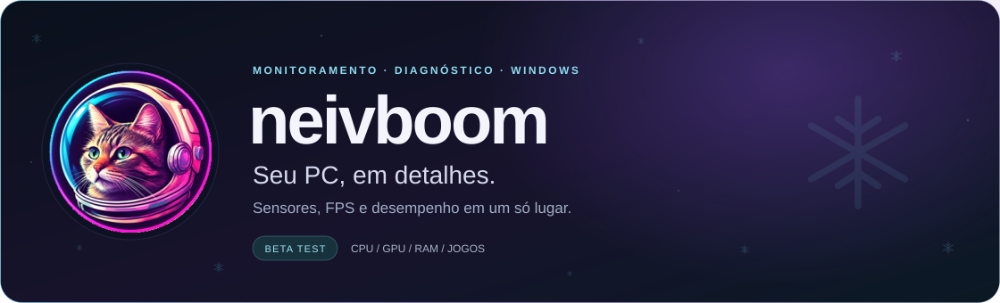
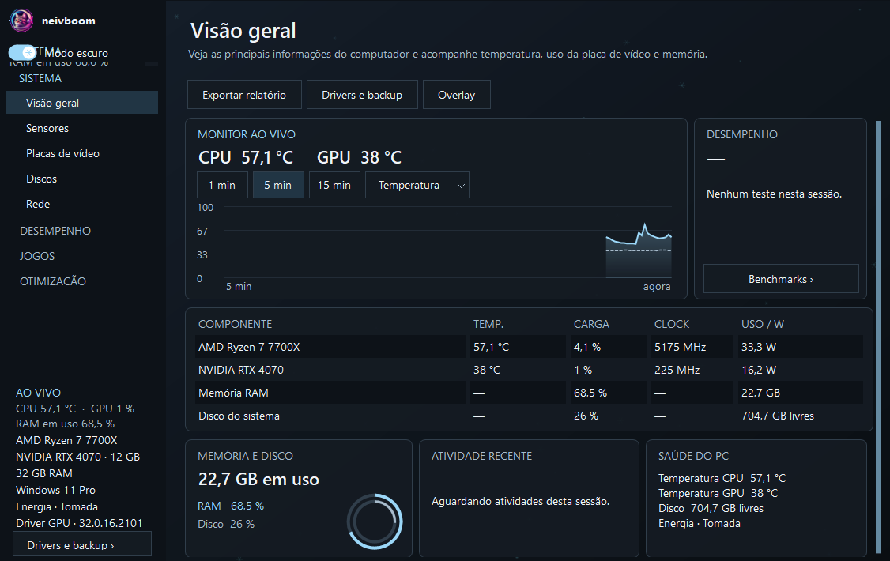
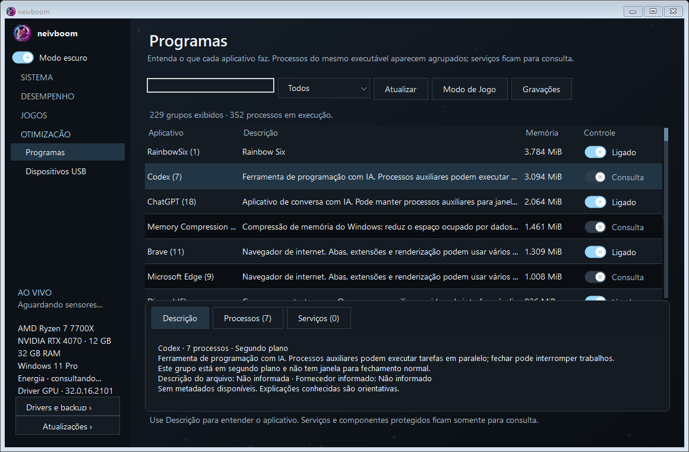

  

  

  <strong>Windows x64</strong> &nbsp;·&nbsp; <strong>Versão beta</strong> &nbsp;·&nbsp; <strong>Interface em português</strong> 
  <a href="https://github.com/NeiveZ/neivboom/releases/latest">Novidades da versão</a> &nbsp; / &nbsp;
  <a href="#instalação">Como instalar</a> &nbsp; / &nbsp;
  <a href="https://github.com/NeiveZ/neivboom/issues/new?template=problema.yml">Relatar um problema</a>

---

### Entenda o que acontece no seu computador

O **neivboom** reúne informações de hardware, sensores e diagnóstico de desempenho em um painel para Windows. Acompanhe o uso dos componentes, registre o FPS durante uma partida e investigue o que pode estar limitando a experiência.

Imagens ilustrativas com dados fictícios, editadas para preservar a privacidade. Não representam uma medição real. As leituras e a disponibilidade dos sensores variam conforme o computador e as permissões do Windows.

### O que você encontra

| Acompanhar | Investigar |
| --- | --- |
| **Sistema e sensores** — CPU, GPU, RAM, temperaturas, clocks e consumo quando disponíveis. | **Jogos e FPS** — biblioteca local, captura de quadros, média, 1% low e tempo de quadro. |
| **Overlay** — números essenciais sobre o jogo, com níveis de detalhe e possíveis limites de desempenho. | **Benchmarks** — CPU, memória, simulação, cópia de buffers na GPU e disco. |
| **Discos e rede** — saúde informada pelo armazenamento, latência e perda de pacotes. | **Programas e USB** — descrições, processos agrupados e controles para os itens elegíveis. |
| **Relatórios** — exportação em HTML e JSON para acompanhar os resultados. | **Drivers** — inventário, backup e consulta de pacotes compatíveis pelo Windows Update. |

<strong>Veja a organização dos programas</strong>

 

Processos do mesmo executável e sessão aparecem juntos. As abas **Descrição**, **Processos** e **Serviços** ajudam a entender cada item. Componentes do Windows, serviços e processos críticos ficam disponíveis para consulta.

### Instalação

1. **Baixe o instalador** pelo botão no início desta página.
2. Abra `NeiveZ.neivboom-win-Setup.exe` e conclua a instalação.
3. Inicie pelo atalho e confira os dados do seu computador.

O instalador inclui o runtime .NET. A plataforma usada nos testes é **Windows 11 de 64 bits**.

**Para medir FPS:** selecione um jogo, clique em **Medir FPS** e volte à partida em até 25 segundos. A captura ETW exige administrador ou uma conta com as permissões de log de desempenho. O aplicativo oferece **Reabrir como administrador**. Para o overlay, prefira **janela sem bordas**.

### Atualizações

Abra o neivboom normalmente, **sem administrador**, e clique em **Atualizações** na lateral. Quando houver uma versão nova, o programa pede confirmação para baixar e reiniciar. Termine os testes e capturas antes de aplicar a atualização.

As configurações e o histórico ficam na pasta de dados do usuário, separados dos arquivos substituídos pelo instalador.

### Antes de começar os testes

O projeto está em **beta**. A indicação de gargalo é uma hipótese baseada nos dados disponíveis; não é uma promessa de FPS máximo. Alguns sensores ou funções podem não estar disponíveis no seu hardware.

<strong>O Windows bloqueou a execução?</strong>

A distribuição de testes ainda não possui assinatura digital de um fornecedor confiável. O Controle Inteligente de Aplicativos e outras políticas do Windows podem bloquear a execução. O bloqueio não é resolvido apenas executando como administrador.

Confira as informações da versão e a [orientação oficial da Microsoft](https://support.microsoft.com/en-us/windows/security/threat-malware-protection/smart-app-control-frequently-asked-questions).

<strong>Qual arquivo devo baixar?</strong>

- **Setup.exe:** opção indicada para instalar e usar o fluxo de atualizações do aplicativo.
- **Portable.zip:** pacote para uso portátil.
- **Source code:** arquivo automático do repositório de distribuição; não é o instalador.
- Os arquivos `.nupkg`, `.json` e `RELEASES` são usados pelo mecanismo de atualização.

Você encontra as opções na [última versão publicada](https://github.com/NeiveZ/neivboom/releases/latest).

### Ajude a melhorar o neivboom

Encontrou um problema durante o teste? [Abra um relato](https://github.com/NeiveZ/neivboom/issues/new?template=problema.yml) com a versão utilizada, o que você tentou fazer e o resultado observado. Uma captura de tela ajuda a reproduzir o caso.

---

  <strong>neivboom</strong> &nbsp;·&nbsp; Desenvolvido por <a href="https://github.com/NeiveZ">NeiveZ</a> 
  Canal oficial de instaladores, versões e relatos de teste.

### Segurança e privacidade

Consulte a [política de segurança](SECURITY.md), os [avisos de privacidade](PRIVACY.md) e as [orientações de suporte](SUPPORT.md). Não publique vulnerabilidades ou dados pessoais em issues. Não desative proteções do Windows para executar a distribuição beta.
