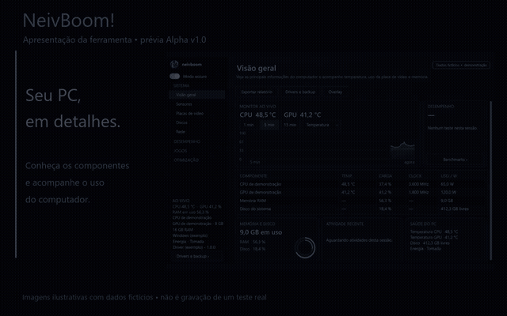
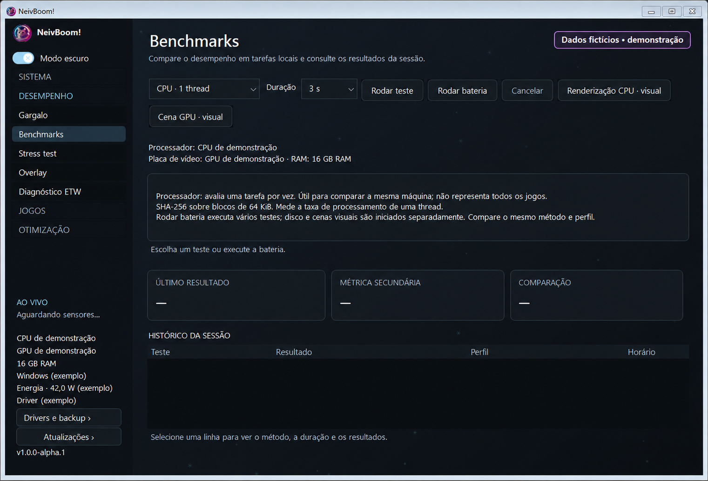
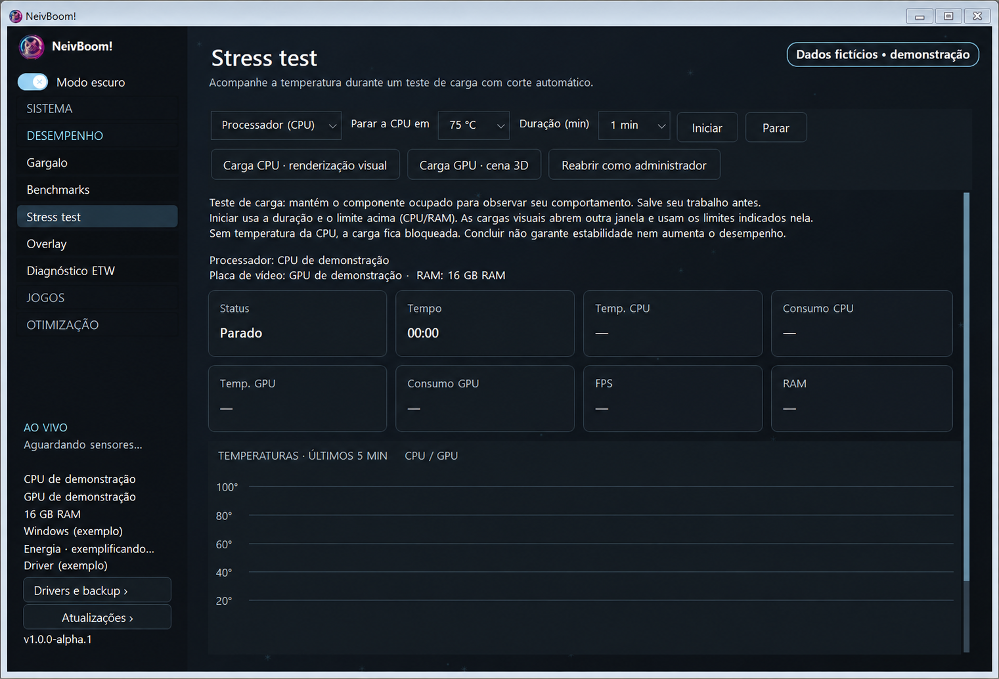
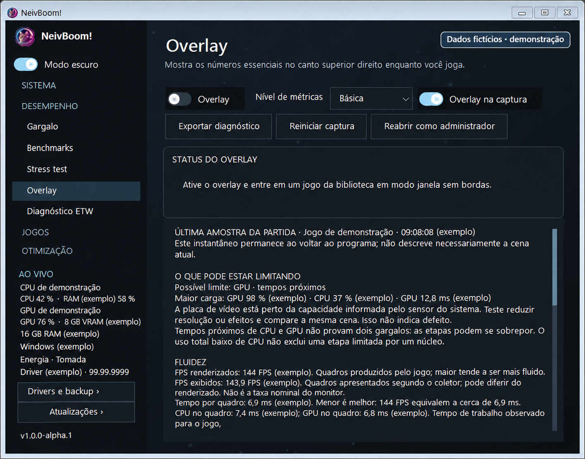

  

  

  <strong>Windows x64</strong> · <strong>Interface em português</strong> · <strong>Projeto em testes</strong> 
  <a href="https://github.com/NeiveZ/NeivBoom-/releases/latest">Última versão pública</a> ·
  <a href="#conheça-as-telas">Galeria</a> ·
  <a href="https://github.com/NeiveZ/NeivBoom-/issues/new?template=problema.yml">Relatar um problema</a>

O **NeivBoom!** ajuda você a acompanhar o computador, medir a fluidez dos jogos e entender o que pode estar limitando o desempenho — com números acompanhados de explicações.

> **Qual versão estou vendo?** O download público atual é a **0.2.5**, uma versão de testes. A **Alpha v1.0 (`1.0.0-alpha.1`)** está em validação local. A apresentação abaixo inclui prévias dessa Alpha; seus recursos ainda não estão todos no instalador público.

### Uma introdução em 20 segundos

[Assistir ou baixar o vídeo MP4](https://github.com/NeiveZ/NeivBoom-/raw/refs/heads/main/assets/introducao-neivboom.mp4) · Sem áudio, com textos em português.

Apresentação ilustrativa feita com imagens editadas e dados fictícios para preservar a privacidade. Não é gravação de uma partida ou de um benchmark real. Layout, recursos e disponibilidade de sensores variam conforme a versão e o computador.

### O que você pode acompanhar

| Área | Para que serve |
| --- | --- |
| **Sistema e sensores** | Identificar componentes e consultar uso, temperaturas, clocks e consumo quando disponíveis. |
| **Jogos e overlay** | Acompanhar FPS e tempo de quadro e investigar possíveis limites da partida. |
| **Benchmarks e estresse** | Comparar tarefas locais e observar o comportamento sob carga. Métodos e limites são explicados antes dos testes. |
| **Discos e rede** | Consultar saúde informada pelo armazenamento, latência e perda de pacotes. |
| **Programas, USB e drivers** | Entender itens do sistema e acessar controles elegíveis, inventário e backup. |
| **Relatórios** | Guardar resultados para comparar e compartilhar após revisar dados pessoais. |

### Em preparação na Alpha v1.0

- **Diagnóstico explicado:** última amostra da partida, significado das métricas e limitações da interpretação.
- **Testes visuais:** renderização pela CPU e cena procedural Direct3D 11 pela GPU.
- **Monitor opcional de aplicativos:** CPU, memória residente e I/O durante a medição manual de FPS, com resumo ao concluir.
- **Interface revisada:** identidade NeivBoom!, versão na lateral e controles alinhados ao tema.

O monitor inicial mostra consumo observado. Ele **não prova que um aplicativo causou uma queda**, não calcula quantos FPS foram perdidos e ainda não oferece GPU por processo. Linha do tempo e comparação antes/depois continuam no planejamento.

### Conheça as telas

Todas as imagens abaixo são ilustrativas e usam dados fictícios.

<strong>Visão geral — componentes e informações do computador</strong>

Uma leitura rápida dos componentes, memória, gráfico e informações do sistema.

<strong>Benchmarks — prévia Alpha</strong>

Cada teste explica o que mede. Resultados de uma cena própria não equivalem a pontuações de outros programas nem preveem o FPS de todos os jogos.

<strong>Stress test — prévia Alpha</strong>

A carga observa o comportamento sob trabalho. Ausência de temperatura pode bloquear o teste; concluir não certifica estabilidade nem melhora o desempenho automaticamente.

<strong>Overlay e explicação da partida — prévia Alpha</strong>

A última amostra permanece para consulta. Uma hipótese de limitação acompanha a evidência disponível; temperatura sozinha não confirma throttling.

<strong>Programas — organização e descrições</strong>

Grupos e descrições ajudam a entender os processos. Itens protegidos permanecem disponíveis para consulta.

### Instalação e atualizações

1. Baixe o **Setup.exe** da [última versão pública](https://github.com/NeiveZ/NeivBoom-/releases/latest).
2. Conclua a instalação e abra o aplicativo pelo atalho.
3. Use **Atualizações** na lateral para consultar versões disponíveis. Termine capturas e testes antes de atualizar.

O instalador inclui o runtime .NET. A plataforma usada nos testes é Windows 11 x64. Os arquivos `.nupkg`, `.json` e `RELEASES` atendem ao mecanismo de atualização; **Source code** deste repositório de distribuição não é o instalador.

A captura ETW pode exigir administrador ou permissões de log de desempenho. Prefira abrir o jogo pelo launcher normalmente e use a elevação oferecida pelo NeivBoom! quando necessária. Para o overlay, prefira janela sem bordas.

### Segurança, privacidade e suporte

A distribuição de testes ainda **não possui assinatura digital de editor confiável**. O Windows pode bloquear a execução. Não desative as proteções para executar o aplicativo; consulte as [orientações da Microsoft](https://support.microsoft.com/en-us/windows/security/threat-malware-protection/smart-app-control-frequently-asked-questions).

Leia a [política de segurança](SECURITY.md), os [avisos de privacidade](PRIVACY.md) e as [orientações de suporte](SUPPORT.md). Vulnerabilidades devem seguir o canal privado indicado na política, sem detalhes de exploração em issues públicas.

Encontrou um problema? Informe versão, passos e mensagem observada pelo [formulário de relato](https://github.com/NeiveZ/NeivBoom-/issues/new?template=problema.yml). Revise imagens e logs antes de anexar; remova dados pessoais e nunca envie senhas ou tokens.

---

  <strong>NeivBoom!</strong> · Desenvolvido por <a href="https://github.com/NeiveZ">NeiveZ</a> 
  Canal oficial de distribuição, atualizações e testes.

